# Microsoft Entra ID IAM | JML Lifecycle Simulation — Cycle 2

### Hands-On Identity & Access Management Portfolio

**Platform:** Microsoft Entra ID  
**Ticketing:** Jira Service Management  
**Scenario:** Adrian Velasco | Joiner → Mover → Leaver  
**Environment:** Personal cloud lab  
**Execution:** October 25–27, 2026  
**Documentation:** October 28, 2026

> **Lab Disclosure:** All activities were completed in a simulated training environment. The Jira offboarding ticket was created retrospectively for technical documentation, not as a pre-approved production request.

---

## Project Overview

This project demonstrates an end-to-end employee identity lifecycle in Microsoft Entra ID, covering account provisioning, role-based group assignment, authentication validation, department transfer, stale-access remediation, user deprovisioning, audit verification, and Jira Service Management documentation.

### Technologies and Skills

- Microsoft Entra ID
- Identity and Access Management (IAM)
- Joiner, Mover, Leaver (JML)
- Role-Based Access Control (RBAC)
- Multi-Factor Authentication (MFA)
- Least Privilege
- Access Provisioning and Deprovisioning
- Directory Audit Logs
- Sign-in Monitoring and Troubleshooting
- Jira Service Management (ITSM)

---

# PHASE 1 | JOINER — Finance Department

**Scenario:** Adrian Velasco joins Finance as a Finance Associate.

**Objective:** Create the employee identity, assign appropriate department access, and validate authentication.

### Evidence 01 — Duplicate Account Verification

Verified the directory for an existing identity before provisioning to reduce duplicate-account risk.

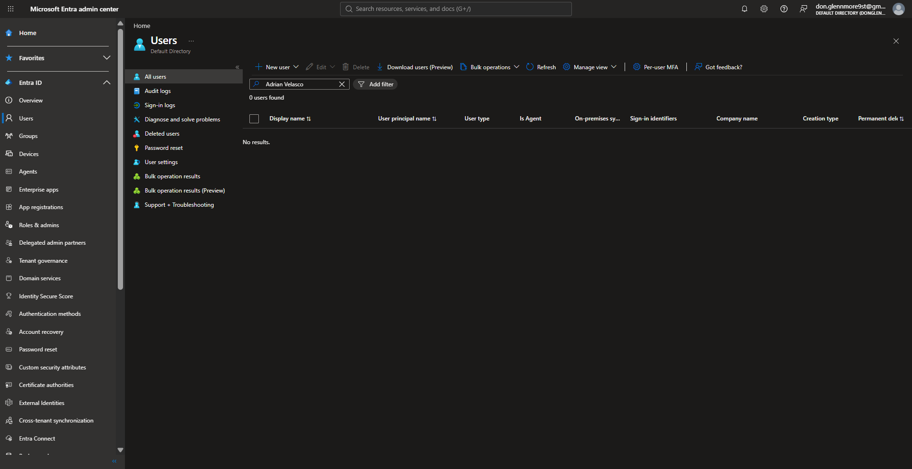

### Evidence 02 — User Account Created

Created the employee identity in Microsoft Entra ID and verified account creation.

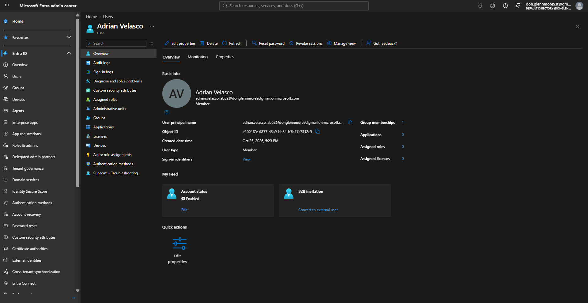

### Evidence 03 — Finance Group Membership

Verified direct membership in the Finance department security group.

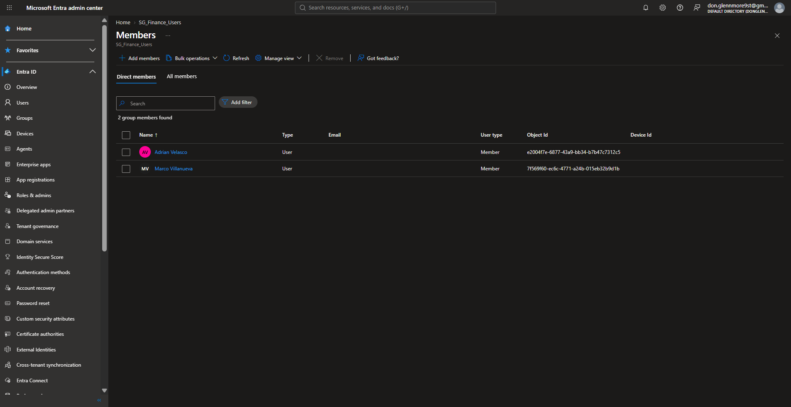

### Evidence 04 — Successful Sign-in Audit

Reviewed Microsoft Entra ID sign-in logs to validate successful authentication.

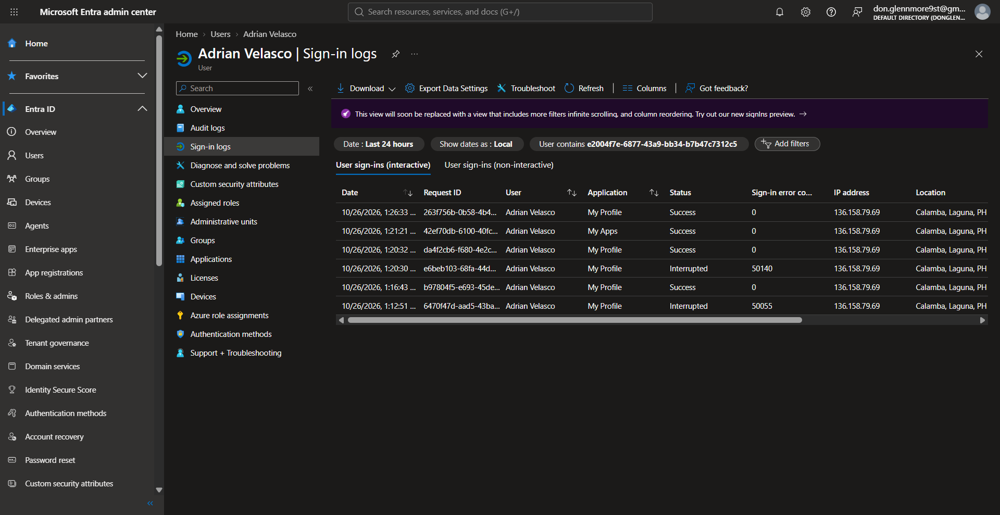

### Evidence 05 — Authenticator Registration

Verified authentication method registration for the simulated employee.

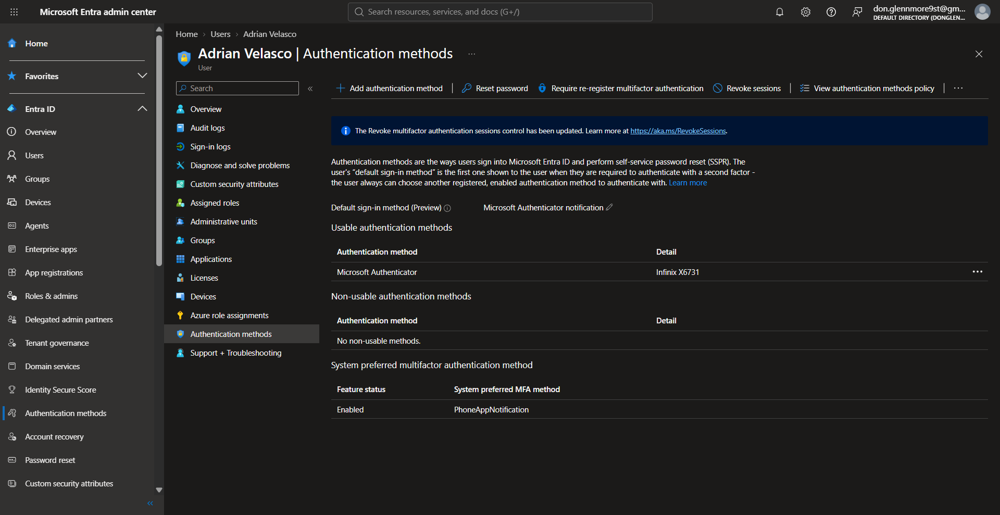

**JOINER RESULT:** Account provisioned, Finance membership verified, and authentication evidence reviewed.

---

# PHASE 2 | MOVER — Finance to Sales

**Scenario:** Adrian transfers from Finance Associate to Sales Associate.

**Objective:** Update the employee's identity attributes, assign appropriate Sales access, and remove stale Finance access.

### Evidence 06 — Old Finance Access Removed

Removed the employee's previous Finance group membership to avoid unnecessary inherited access.

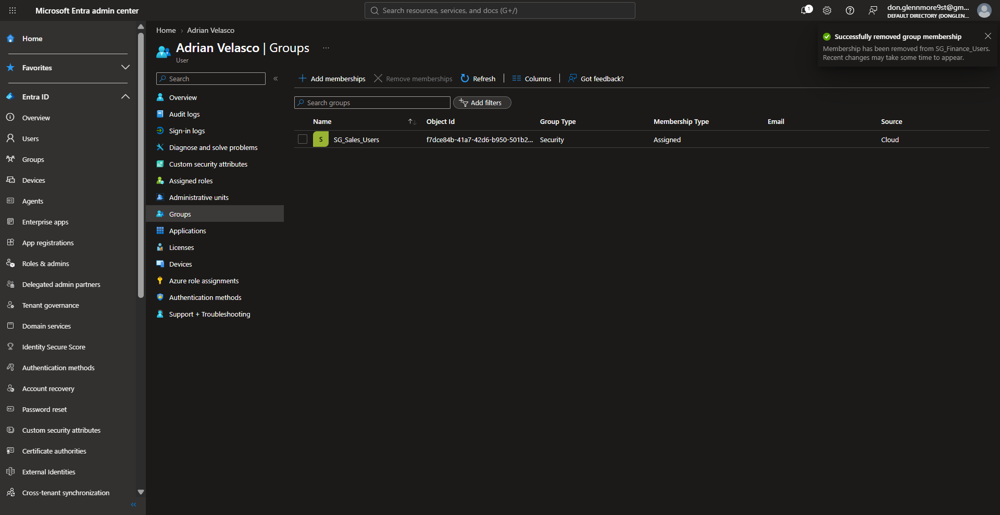

### Evidence 07 — Sales Membership Verified

Verified direct membership in the Sales security group following the department transfer.

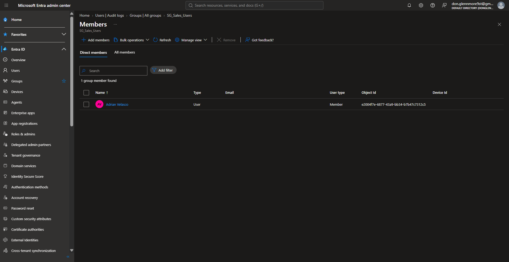

### Evidence 08 — Department Transfer Audit

Reviewed the audit record confirming the change in department and job title from Finance to Sales.

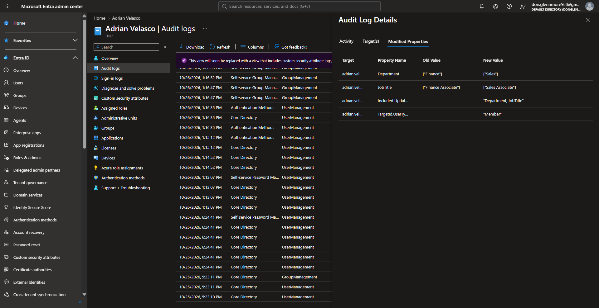

**MOVER RESULT:** Department transfer completed, Sales membership verified, and prior Finance membership removed.

**Security Principle:** Least Privilege and Stale-Access Remediation.

---

# PHASE 3 | LEAVER — Employee Offboarding

**Scenario:** Adrian leaves the simulated organization.

**Objective:** Disable the employee identity, remove directory-level access, revoke supported sessions, and validate the result.

### Evidence 09 — Final Disabled Account State

Confirmed that the employee account was disabled and no group memberships remained.

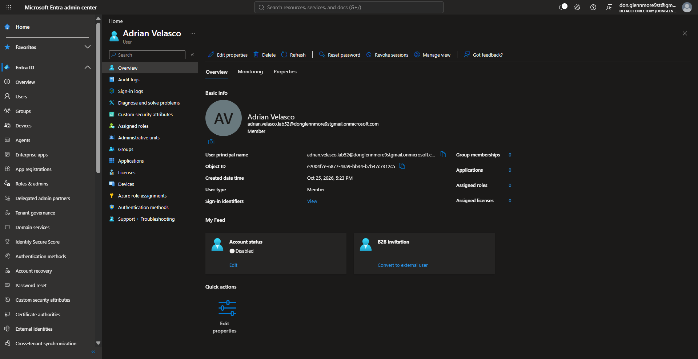

### Evidence 10 — Blocked Sign-in Validation

Attempted authentication after disabling the account.

Microsoft Entra ID returned **AADSTS50057**, indicating that the user account was disabled.

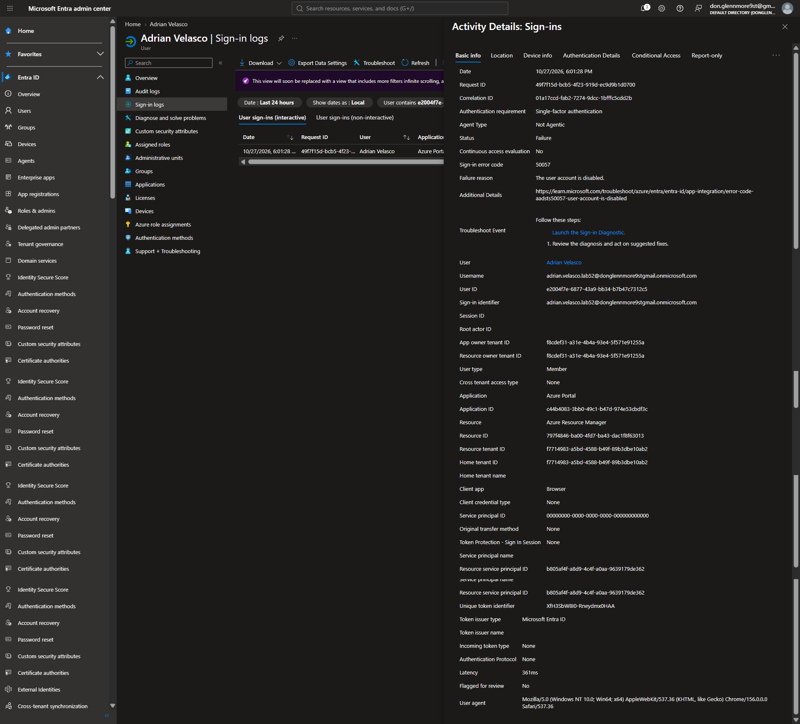

### Evidence 11 — Account Disablement Audit

Reviewed the successful account-disablement audit event, including the AccountEnabled attribute changing from true to false.

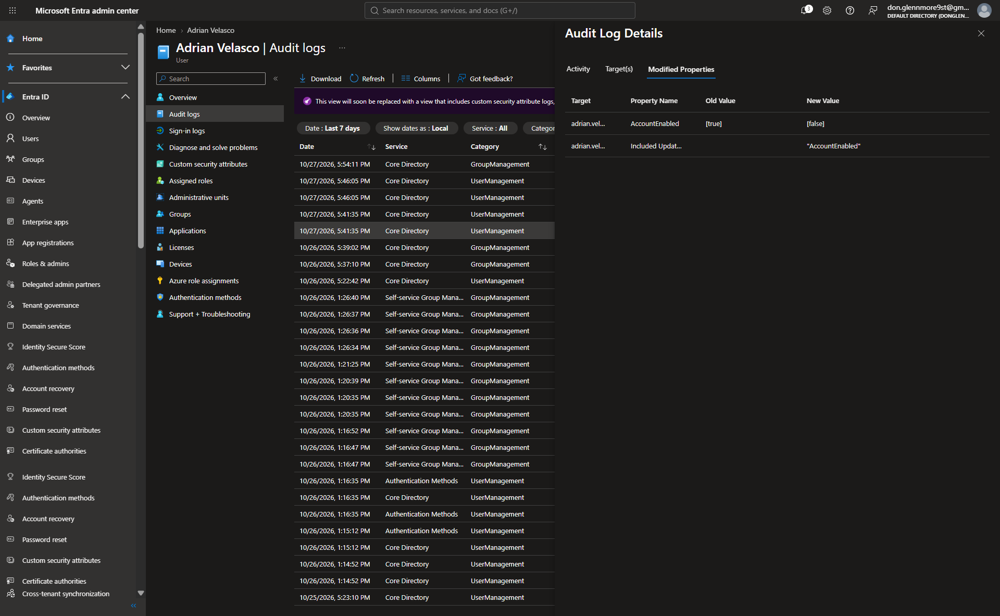

### Evidence 12 — Sales Group Removal Audit

Verified the successful removal of the employee's Sales security group membership through Microsoft Entra ID audit logs.

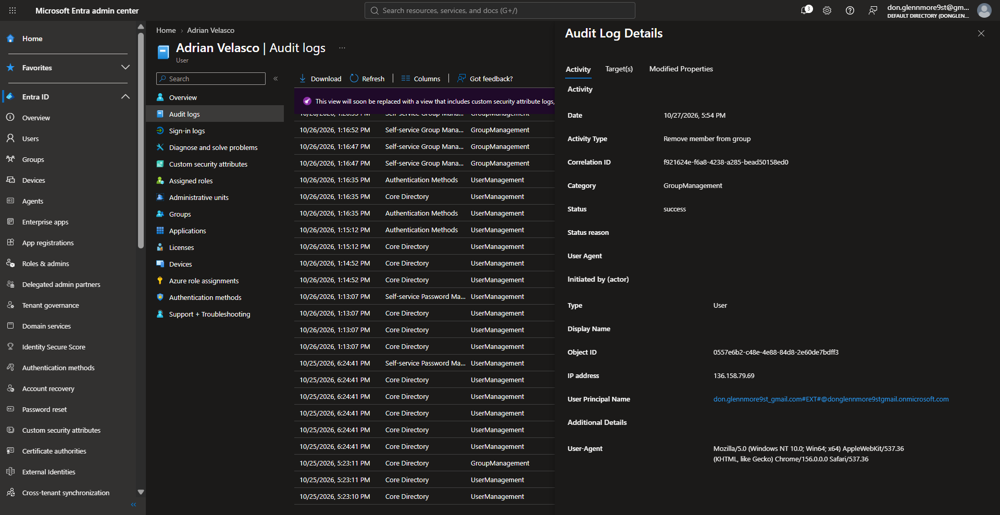

### Evidence 13 — Session Revocation Audit

Reviewed the successful session revocation operation and supporting refresh-token validity timestamp audit event.

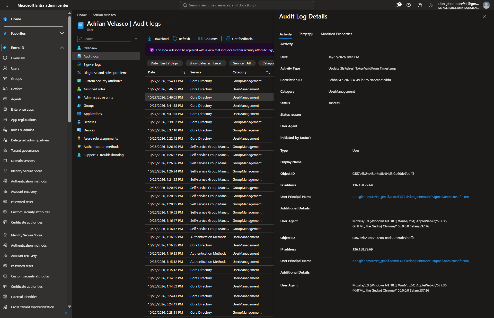

### Leaver Verification Summary

| Security Control | Verified Result |
|---|---|
| Account status | Disabled |
| AccountEnabled | true → false |
| Remaining group memberships | 0 |
| Assigned applications | 0 |
| Assigned directory roles | 0 |
| Supported session revocation | Successful operation |
| Post-disablement sign-in | Blocked as expected |
| Sign-in error | AADSTS50057 |
| Group removal audit | Success |
| Account disablement audit | Success |

**LEAVER RESULT: PASS**

The tested Microsoft Entra ID directory-level offboarding controls were successfully validated.

**Scope Limitation:** Immediate invalidation of previously issued access tokens and external application sessions was not independently verified.

---

# PHASE 4 | JIRA SERVICE MANAGEMENT — ITSM CLOSURE

**Ticket:** IAM-7  
**Request:** Employee Offboarding — Adrian Velasco  
**Request Type:** Get IT help  
**Assignee:** Glennmore Asis  
**Status:** Resolved  
**Resolution:** Done

The completed lab activities were documented retrospectively in Jira Service Management, including the technical actions, audit evidence, validation results, and scope limitations.

### Evidence 14 — Jira Ticket Resolved / Done

Verified that the retrospective offboarding ticket reached its final resolution state.

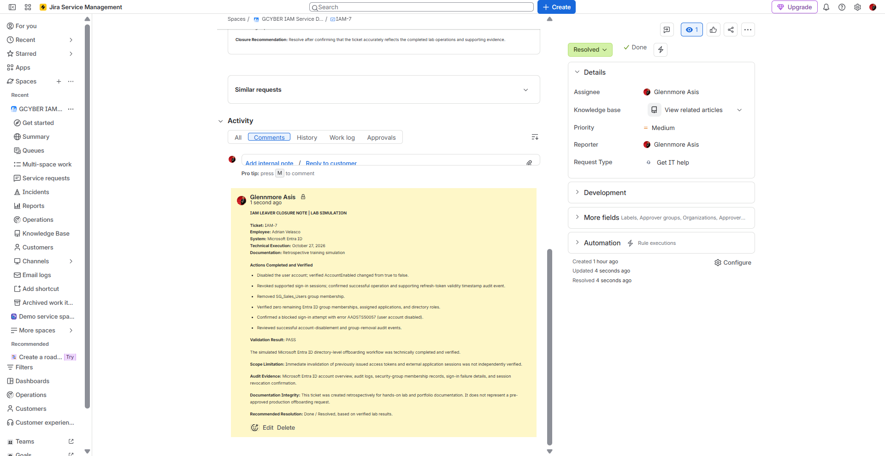

### Evidence 15 — Internal Closure Note Verified

Documented the completed operations, supporting evidence, validation result, limitations, and retrospective training disclosure in the internal Jira closure note.

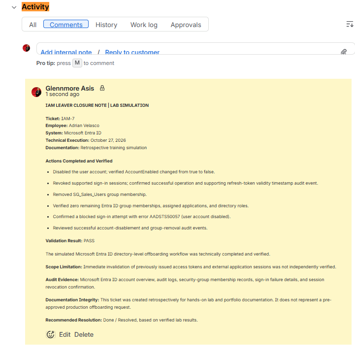

**ITSM RESULT:** Retrospective lab ticket documented and resolved.

---

# SECURITY CONTROLS DEMONSTRATED

| Control | Implementation |
|---|---|
| Identity Lifecycle Management | Joiner, Mover, Leaver |
| Role-Based Access Control | Finance and Sales groups |
| Least Privilege | Removal of outdated department membership |
| Authentication Validation | Successful and failed sign-in analysis |
| Account Deprovisioning | Account disablement |
| Access Revocation | Security group removal |
| Session Revocation | Supported session revocation operation |
| Auditability | Microsoft Entra ID audit and sign-in logs |
| ITSM Documentation | Jira internal closure note and resolution |

---

# PROJECT OUTCOME

**Completed Simulated Workflow**

- 1 Joiner scenario
- 1 Mover scenario
- 1 Leaver scenario
- Finance-to-Sales access transition
- Authentication and directory audit verification
- Successful user account disablement
- Verified access group removal
- Blocked post-disablement sign-in
- Session revocation operation and audit review
- 1 retrospectively documented and resolved Jira ticket
- 15 curated evidence screenshots

**Technical Validation:** PASS for the tested directory-level controls.

---

## Author

**Glennmore U. Asis**

CompTIA Security+ | ISC2 Certified in Cybersecurity (CC) | Registered Criminologist

**Career Focus:** Identity & Access Management, Microsoft Entra ID, Identity Operations, Access Provisioning, and Cybersecurity.

*This repository demonstrates hands-on personal lab training and does not represent production employment experience.*
